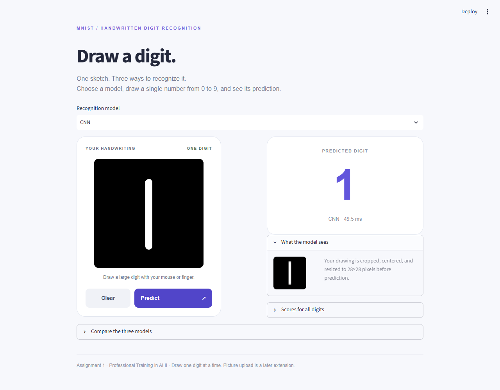

# MNIST Digit Classifier

Train and compare Random Forest, MLP and CNN models, then draw a digit in a Streamlit app and choose a saved model for prediction.

## Run the app

Use Python 3.12. From the repository root:

```powershell
python -m venv .venv
.\.venv\Scripts\Activate.ps1
python -m pip install -r requirements.txt
python -m streamlit run app.py
```

Open **http://localhost:8501**. Draw one digit from 0 to 9 using your mouse or finger, select a model, and click **Predict**. **Clear** resets the canvas. **What the model sees** previews the prepared 28 by 28 input.



## Results

| Model | Selected trial | Validation accuracy | Test accuracy | Macro F1 |
| --- | --- | --- | --- | --- |
| Random Forest | C | 96.65% | 96.95% | 0.9693 |
| MLP | B | 97.47% | 97.62% | 0.9761 |
| CNN | B | 98.74% | 99.02% | 0.9901 |

Recommended model: **CNN**, selected using validation accuracy. The [report](docs/report.md) explains the experiments, final settings, errors, complexity and timing. The [methodology](docs/methodology.md) describes data preparation and model selection.

## Project layout

Keep the three notebooks separate. Each trains one model family; the app loads all three saved models.

| Training notebook | Trials | Final artifact |
|---|---:|---|
| Random_forest_.ipynb | 3 | models/rf_final.joblib |
| Mlp.ipynb | 5 | models/mlp_final.keras |
| CNN.ipynb | 3 | models/cnn_final.keras |

`app.py` starts Streamlit. `assets/` and `canvas_component.py` provide the drawing canvas; `preprocessing.py` prepares the image; `model_io.py` loads the models. `results/` holds recorded training outputs, metrics and plots. The original assignment brief is [Assignment 1.md](Assignment%201.md).

The root notebooks have been rearranged into smaller cells closer to the original layout, keeping the original study notes with brief factual corrections. Their outputs are cleared so they do not imply the rearranged cells were rerun. Previously executed notebooks in `results/<model>/executed.ipynb` are unchanged snapshots of the completed training runs, including the notes that existed at that time.

## Training changes

The original RF and CNN notebooks already had useful validation splits and experiments. The original MLP's one-hot labels with categorical cross-entropy were valid too.

- **MLP:** added the shared stratified 50,000/10,000 training/validation split and five trials covering width, learning rate, batch size and L2. Uses Dense computational layers, integer labels with sparse cross-entropy, validation checkpoints and early stopping. Removing the original Dropout follows the assignment's literal fully-connected-only wording; Dropout itself was not an error. Changing the label representation alone does not improve accuracy.
- **RF:** kept the three tree/depth experiments and compressed saving; added automatic validation-based selection and consistent evaluation.
- **CNN:** kept the simple two-stage architecture and three configurations; fixed best-only checkpoint saving and added early stopping and automatic selection.
- **All three:** use float32 pixels divided by 255 once, consistent evaluation, saved final models and reload checks. RF/MLP use 784 features; CNN uses 28 by 28 by 1.

We retrained to produce saved models and measured results matching those training changes. **This notebook/documentation cleanup does not retrain or change the saved models. Pushing to GitHub and deploying do not retrain either:** the app loads the existing artifacts. Changing training data, architecture or training settings requires rerunning the affected experiments.

For deliberate retraining, environment setup and laptop-specific launch commands, see [local setup](docs/local_setup.md). App dependencies are in `requirements.txt`; training, GPU and optional browser-check dependencies are separate. Dependency locks record the working environments.

## Verification

```powershell
python -m unittest discover -s tests -v
python tools/check_saved_models.py
python tools/compare_results.py
```

The saved-model check uses ten enlarged MNIST samples through drawing preprocessing; this is an integration check, not a handwriting accuracy benchmark. Optional mouse/touch browser checks are described in [local setup](docs/local_setup.md). After retraining, refresh saved-model and browser checks before running `python tools/build_report.py` to regenerate the report and this README.

## GitHub and next steps

Repository: [4awmy/MNIST-Digit-Classifier](https://github.com/4awmy/MNIST-Digit-Classifier). The [archive/full-project branch](https://github.com/4awmy/MNIST-Digit-Classifier/tree/archive/full-project) preserves the full version before cleanup, including extra explanations and documents. Backups, environments and intermediate checkpoints stay outside Git.

1. Review the notebooks, methodology and report so the team can explain the experiments and model choice. Confirm the collaborator invitation was accepted.
2. Deploy `main` / `app.py` with Python 3.12 using the [Streamlit deployment guide](docs/deployment.md). The app uses CPU inference and the committed model files.
3. Test drawing, Predict, Clear, all three models, touch input and the processed preview on the live app. Then add its public URL here and to the report.
4. Add picture upload afterward, reusing the image preparation and saved models. Start with one clear digit per image and validate representative uploads.
