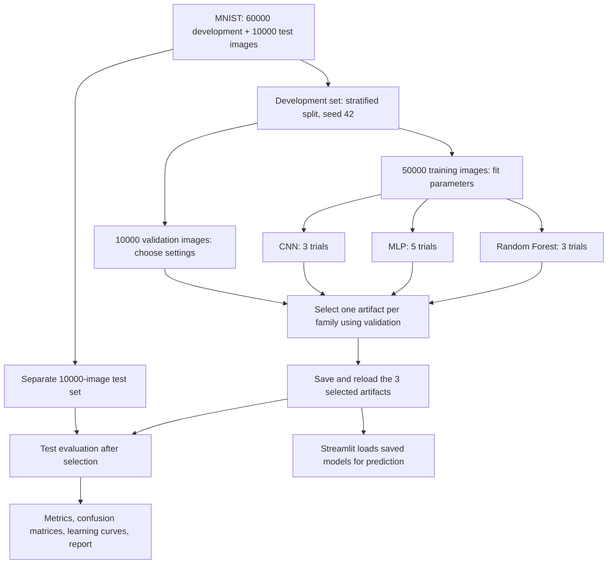
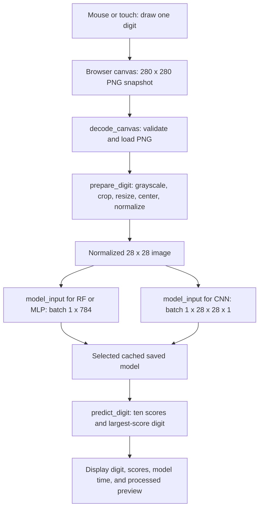
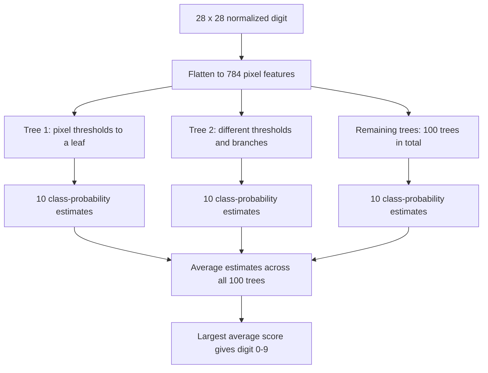
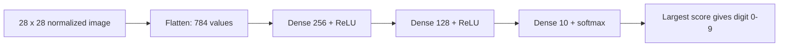
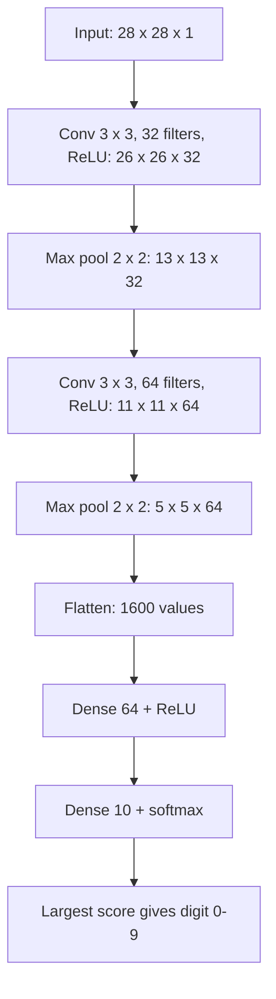

# MNIST Digit Classifier

Assignment 1 for Professional Training in AI II: train and compare a Random Forest, a fully connected multilayer perceptron (MLP), and a simple convolutional neural network (CNN), then recognize a digit drawn in a Streamlit application.

**[Open the Streamlit app](https://mnist-digit-classifier-aast.streamlit.app/)** · **[Read the report below](#assignment-report)** · **[Standalone report](report.md)**

The app supports mouse and touch drawing, model selection, clearing the canvas, a processed-image preview, and scores for digits 0–9. All three trained models are included. **CNN is the recommended default:** it achieves **99.02% test accuracy** on MNIST.

This README includes the complete assignment report, all five report figures, architecture diagrams, and the implementation guide. The standalone report remains available for separate submission.

## Contents

- [Use the application](#use-the-application)
- [Run the project](#run-the-project)
- [Files and assignment deliverables](#files-and-assignment-deliverables)
- [How the system works: workflow diagrams](#how-the-system-works)
- [Assignment report](#assignment-report)
- [Data preprocessing and experimental methodology](#data-preprocessing-and-experimental-methodology)
- [What the models are and how they work](#what-the-three-models-are-and-how-they-work)
- [Random Forest architecture and explanation](#random-forest-many-decision-trees-combined)
- [MLP architecture and explanation](#mlp-learned-connections-between-all-units-in-consecutive-layers)
- [CNN architecture and explanation](#cnn-local-image-features-with-shared-filters)
- [Why these preprocessing and training choices](#why-these-shared-preprocessing-and-training-choices)
- [Hyperparameter search and final choices](#hyperparameter-search-and-final-choices)
- [Training results and test comparison](#training-results-and-test-comparison)
- [All five figures and their interpretation](#generalization-and-interpretation-of-figures)
- [Why CNN is the recommended model](#best-model-decision-and-trade-offs)
- [Functions and component behavior](#functions-and-component-behavior)
- [Imports and dependencies](#imports-and-dependencies)
- [Saved models, GitHub, and deployment](#saved-models-github-and-deployment)
- [Limitations and troubleshooting](#limitations-and-troubleshooting)

## Use the application

1. Open the [app](https://mnist-digit-classifier-aast.streamlit.app/).
2. Select **CNN**, **MLP**, or **Random Forest**. CNN is selected initially.
3. Draw one large digit from **0 to 9** on the black canvas using a mouse, finger, or pen. Use one digit per prediction.
4. Press **Predict**. The result shows the recognized digit, model name, and model execution time.
5. Expand **What the model sees** to inspect the centered 28×28 input, or **Scores for all digits** to compare the ten output scores.
6. Press **Clear** to start another drawing. After editing a drawing or changing models, press **Predict** again; the previous result is cleared to avoid showing stale scores.

**Compare the three models** displays the saved MNIST test results. That table describes the benchmark, not the correctness of the current drawing. The score chart contains normalized model scores; a high score is not a guaranteed probability of being correct.

## Run the project

Use **Python 3.12**. From the project folder, create an environment and install the pinned dependencies:

```powershell
python -m venv .venv
.\.venv\Scripts\Activate.ps1
python -m pip install -r requirements.txt
python -m streamlit run app.py
```

On macOS/Linux, use `source .venv/bin/activate` for the activation step. Open **http://localhost:8501** after Streamlit starts. Run commands from the folder containing `app.py` and `requirements.txt`.

The app requires the three existing files in `models/`. **Starting the app does not train models or download MNIST.** The requirements use CPU TensorFlow for application inference; a GPU is not required to recognize a drawing.

To open the training notebooks, install Jupyter separately in the same environment:

```powershell
python -m pip install jupyterlab
python -m jupyterlab
```

Open a notebook from the project root and run its cells in order. Select the Python environment in which the requirements were installed. Training can use CPU or a separately configured compatible GPU environment; the supplied requirements do not install a GPU setup.

## Files and assignment deliverables

| File or folder | Purpose |
| --- | --- |
| [Random_forest_.ipynb](Random_forest_.ipynb) | Load and prepare MNIST, tune the forest, evaluate and save the selected forest. |
| [Mlp.ipynb](Mlp.ipynb) | Train and tune the Dense-only neural network; save the selected checkpoint and figures. |
| [CNN.ipynb](CNN.ipynb) | Train and tune the introductory CNN; save the selected checkpoint and figures. |
| [models/](models/) | `rf_final.joblib`, `mlp_final.keras`, and `cnn_final.keras`: the three saved models used by the app. |
| [report.md](report.md) | Standalone short report; its full content is also included in this README. |
| [report_assets/](report_assets/) | Three test confusion matrices and two sets of neural learning curves, embedded and interpreted below and in the standalone report. |
| [app.py](app.py) | Streamlit interface, model caching, session state, prediction display, and comparison table. |
| [preprocessing.py](preprocessing.py) | Decode a drawing, prepare its pixels, and reshape the input for each model. |
| [model_io.py](model_io.py) | Load saved artifacts, check their interfaces, and produce a common prediction result. |
| [canvas_component.py](canvas_component.py) | Register the custom Streamlit drawing component. |
| [assets/](assets/) | Canvas HTML, CSS, and JavaScript for drawing, Clear, and Predict. |
| [results/comparison.csv](results/comparison.csv) | One summary row per selected model; supplies the app's comparison table. |
| [requirements.txt](requirements.txt) | Pinned application and notebook dependencies. |
| [.streamlit/config.toml](.streamlit/config.toml) | Shared theme, headless server setting, and usage-statistics setting. |
| [.gitignore](.gitignore) | Exclude environments, caches, temporary checkpoints, backups, and secrets from Git. |

These map to the five assignment deliverables: training source, saved models, a short report, application source, and run instructions. The three notebooks stay **separate** because each contains one model family's complete experiment. They share the same dataset split and evaluation rules; the app and report combine their results. Combining them into one notebook is unnecessary.

## How the system works

There are two workflows. Training learns and saves model parameters; the application loads them for inference. Hyperparameters are settings chosen before fitting, such as tree count or learning rate. A Predict click uses already learned parameters and never starts notebook training.



The three trials for RF, five for MLP, and three for CNN are candidate configurations within **three model families**. One final artifact per family is supplied to the app. Validation selects among candidates; the test set is not part of that choice.



`results/comparison.csv` supplies benchmark values for the comparison panel. It is display data, not model weights: a missing table does not prevent inference when the selected artifact is available. Session state retains each user's drawing and result; resource caching avoids reloading models on each rerun.

## Assignment report

The complete report follows: objectives, preprocessing, model explanations and architectures, every hyperparameter trial, training/test comparisons, all report figures, and the final selection rationale. Detailed setup and implementation sections surround it in this same README.

### Objective and deliverables

Compare three model families for handwritten digits: a classical Random Forest, a fully connected MLP, and a simple CNN. Tune their hyperparameters, save one selected model per family, and justify the best choice using accuracy, generalization, complexity, and computational cost. The [Streamlit application](https://mnist-digit-classifier-aast.streamlit.app/) lets a user draw a digit and switch between the three saved models. Training source is provided in the three separate notebooks; application instructions and function explanations are in [the implementation guide below](#functions-and-component-behavior).

### Data preprocessing and experimental methodology

#### MNIST used for experiments

MNIST consists of grayscale images of single handwritten digits, each **28×28 pixels**, with labels **0–9**. Keras supplies 60,000 development images and a separate 10,000-image test set. Each notebook uses `train_test_split` with `test_size=10000`, `random_state=42`, and stratification by label:

| Partition | Images | Role |
| --- | --- | --- |
| Training | 50,000 | Fit tree decisions or neural weights. |
| Validation | 10,000 | Select hyperparameters and neural checkpoints. |
| Test | 10,000 | Evaluate the selected model from each family. |

Stratification approximately preserves the proportion of every digit in both development partitions. The same seed and split across notebooks support a fair accuracy comparison. Test images are not used to select hyperparameters or stopping epochs.

Pixel arrays are converted to `float32` and divided by **255 exactly once**, converting intensities from 0–255 to 0–1. Normalization helps neural optimization and gives all models a consistent input contract; trees do not require scaling in the same way. No additional standardization, augmentation, or external training images are used.

| Model | One training example | One application batch |
| --- | --- | --- |
| Random Forest | `(784,)` flattened pixels | `(1, 784)` |
| MLP | `(784,)` flattened pixels | `(1, 784)` |
| CNN | `(28, 28, 1)` image with grayscale channel | `(1, 28, 28, 1)` |

Flattening preserves pixel order but removes the explicit two-dimensional input structure. Integer labels are retained. The networks use **sparse categorical cross-entropy**, which accepts these integers; one-hot labels with categorical cross-entropy would be an alternative representation, not a required extra step.

#### Drawings used for prediction

The browser canvas is **280×280**, with white strokes on black, matching MNIST's bright-digit/dark-background convention. It is prepared differently from the already formatted MNIST images:

1. Decode the PNG data URL. Reject malformed input, encoded payloads over 3,000,000 characters, or images over 1,000,000 pixels.
2. Composite transparency onto black and convert to grayscale.
3. Find foreground pixels brighter than **15**. Fewer than **10** foreground pixels is treated as a blank drawing.
4. Crop to the foreground bounding box. This threshold locates the bounds; it does **not** turn the image into a binary black-and-white mask.
5. Resize with LANCZOS interpolation, preserving aspect ratio, so the longest side is **20 pixels**.
6. Place the resized digit in a black **28×28** square, then shift it toward the center using its intensity-weighted center of mass.
7. Convert to `float32`, divide by 255 once, and reshape for the selected model.

Cropping removes unused canvas space, aspect-ratio preservation avoids stretching, and centering reduces position differences from MNIST. The preview makes this transformation visible. These are practical heuristics; unusual strokes or drawings at the canvas edge can still be difficult to recognize. `model_input` checks shape, finite values, and the 0–1 range without dividing a second time.

The search compares controlled alternatives rather than using defaults alone. Every trial uses seed 42. Neural trials reset the seed and request deterministic TensorFlow operations. Results come from one run per configuration, so small validation differences are observations, not evidence of statistically certain improvements across repeated runs.

### What the three models are and how they work

All three solve the same **supervised classification** problem: given pixels, choose one of ten digit labels. Training examples provide both the image and correct label. The models differ in how they represent the relationship between those pixels and the answer. A trained parameter is learned from examples; a hyperparameter, such as layer width or tree count, is chosen before training.

We use these three families because they meet the assignment's three categories and provide a useful comparison: a classical ensemble, a fully connected neural network, and a basic image-focused network. Their different assumptions let us compare whether explicitly preserving image structure helps this task.

#### Random Forest: many decision trees combined

A **decision tree** asks a sequence of questions about pixel values. A simplified question could be “is this pixel's normalized brightness below a threshold?” Depending on the answer, the example moves to a different branch. Training chooses features and thresholds that separate the labels; the default Gini criterion favors child groups with less label mixing. A leaf stores class proportions from the training examples that reach it. The actual learned thresholds and paths differ between trees; the diagram shows the structure, not a specific learned tree.

A **Random Forest** builds many such trees. Bootstrap samples vary the examples used to build each tree, and random feature subsets vary the split candidates. This diversity reduces dependence on any one tree's decisions. For an image, each tree supplies class scores; scikit-learn averages these probability estimates and selects the class with the highest average. It is therefore important to distinguish probability averaging from counting only each tree's winning label.



**Selected structure:** 100 trees, no configured depth cap, **862,140 total nodes**, and **observed maximum depth 41**. Unlimited depth means trees may keep growing subject to their stopping rules; it does not mean infinitely many nodes. Unlike a neural network, a forest has no Dense layers, backpropagation, Adam optimizer, batch size, or training epochs.

**Why use it?** It supplies the required classical baseline, handles nonlinear decisions, and fits quickly in the measured experiment. **What is the cost?** Trees operate on pixel features without shared spatial filters, the unrestricted forest fits the training set perfectly, and its saved artifact is the largest. Averaging trees helps generalization but does not eliminate overfitting. The depth experiment checks that trade-off rather than assuming unlimited depth is always better.

#### MLP: learned connections between all units in consecutive layers

A **multilayer perceptron** is a feed-forward neural network of fully connected layers. Each Dense unit forms a weighted sum of its inputs plus a bias: `z = sum(weight_i * input_i) + bias`. A hidden layer applies **ReLU**, `max(0, z)`, to create nonlinear features. Without nonlinear activations, stacking Dense layers would still represent only a linear transformation before the final classifier.

The flattened 784 pixel values pass through **256**, then **128**, hidden units. The final layer computes ten logits and applies **softmax**: `score_k = exp(logit_k) / sum(exp(logit_j))`. These scores sum to one, and the largest score supplies the prediction. Their normalization does not guarantee calibration on unfamiliar drawings.



| Selected MLP stage | Input width | Output width | Parameter calculation | Parameters |
| --- | --- | --- | --- | --- |
| First Dense + ReLU | 784 | 256 | `784 * 256 + 256` | 200,960 |
| Second Dense + ReLU | 256 | 128 | `256 * 128 + 128` | 32,896 |
| Output Dense + softmax | 128 | 10 | `128 * 10 + 10` | 1,290 |
| **Total** | | | | **235,146** |

During training, **sparse categorical cross-entropy** penalizes the negative log score assigned to the correct integer label. Backpropagation computes how each weight contributed to that loss, and **Adam** uses gradient estimates to update weights. A batch is the group of examples used for an update; an epoch is one pass over the training examples. Validation examples measure progress without contributing gradient updates.

**Why this architecture?** Two hidden layers provide nonlinear capacity while respecting the assignment's fully connected requirement. The wider first layer is selected by validation evidence, not by assuming a bigger network must win. ReLU is simple and supports nonlinear representations; softmax matches ten mutually exclusive labels; sparse cross-entropy matches the integer labels; Adam provides adaptive gradient updates. These activation, loss, and optimizer choices are fixed design choices, not separately tuned experimental winners.

**Selected settings:** Adam learning rate **0.001**, batch **128**, no L2, maximum **20 epochs**, patience **3**, selected checkpoint at epoch **5**. L2 was tested by adding a penalty on hidden-layer weight magnitudes; it does not add a new computational layer. The selected architecture has no active Dropout.

**Trade-off:** the MLP learns useful pixel combinations and gives the fastest measured warmed single-image CPU prediction. However, each input position has its own Dense weights. The network can learn relationships between neighboring pixels, but it has no built-in convolutional locality or weight sharing. Its first Dense layer accounts for most of its parameters.

#### CNN: local image features with shared filters

A **convolutional neural network** keeps the digit's height and width explicit. A small learned filter slides over the image; at each location, it combines a local patch into a feature value. The same filter weights are reused across positions, so a useful local pattern can be detected in several parts of the image. Filters can learn stroke-like patterns, though their exact interpretation would require inspecting learned activations.

The first stage learns **32 filters** from the grayscale input. The next learns **64 filters** from the first stage's feature maps. Each convolution uses a **3×3 kernel**, stride **1**, and **valid padding**, so no border padding is added. ReLU supplies nonlinearity. A **2×2 max-pooling** layer takes the strongest activation in each pooling window, reducing spatial size and computation; it can reduce sensitivity to small shifts but does not make the model fully translation-invariant.



| Selected CNN stage | Output shape, excluding batch | Parameter calculation | Parameters |
| --- | --- | --- | --- |
| Input | 28×28×1 | — | 0 |
| Conv2D, 32 filters, 3×3, ReLU | 26×26×32 | `(3 * 3 * 1 + 1) * 32` | 320 |
| Max pooling, 2×2 | 13×13×32 | No learned weights | 0 |
| Conv2D, 64 filters, 3×3, ReLU | 11×11×64 | `(3 * 3 * 32 + 1) * 64` | 18,496 |
| Max pooling, 2×2 | 5×5×64 | No learned weights | 0 |
| Flatten | 1,600 | `5 * 5 * 64` values; no weights | 0 |
| Dense, 64, ReLU | 64 | `1600 * 64 + 64` | 102,464 |
| Dense, 10, softmax | 10 | `64 * 10 + 10` | 650 |
| **Total** | | | **121,930** |

For example, valid convolution changes width 28 to `28 - 3 + 1 = 26`; pooling changes 26 to 13. After the second convolution, 13 becomes 11; pooling gives 5, using the default pool stride of 2. Flatten converts the resulting 5×5×64 features into the classifier's 1,600 inputs. Pooling and Flatten change representations without adding trainable parameters.

**Why this architecture?** Two convolution/pooling stages keep the model within the assignment's introductory CNN scope. Small kernels extract local features; more filters test additional capacity; pooling limits downstream dimensions; Dense(64) supplies a compact nonlinear classifier. The 3×3 kernels, 2×2 pooling, and Dense(64) are fixed design choices. The experiment tests filter counts and learning rate rather than claiming to have optimized every architectural setting. No pretrained network, augmentation, or extra deep backbone is used.

**Selected settings:** filters **32/64**, Dense width **64**, Adam learning rate **0.001**, batch **128**, maximum **20 epochs**, patience **3**, selected checkpoint at epoch **7**. Training uses the same gradient/backpropagation process and sparse cross-entropy as the MLP; the learned representation differs.

**Trade-off:** spatial weight sharing suits digit images and produces fewer parameters than the selected MLP. Nevertheless, convolution performs many operations across feature-map locations, so fewer parameters do not automatically mean faster inference. Its measured accuracy and size are strongest, while the MLP's measured single-image execution is faster.

#### Why these shared preprocessing and training choices?

| Choice | Reason | Evidence or boundary |
| --- | --- | --- |
| Stratified 50,000/10,000 split, seed 42 | Give all families the same development partitions and preserve class proportions. | Supports comparison; one split does not measure all sampling uncertainty. |
| Separate 10,000-image test set | Assess the selected artifacts after tuning. | Test scores confirm selection; they do not choose hyperparameters. |
| `float32` pixels divided by 255 | Keep neural input magnitudes controlled and a consistent model contract. | Applied once; scaling is not a necessary tree-specific transformation. |
| Integer labels and sparse cross-entropy | Match the ten-class problem without one-hot expansion. | One-hot labels with categorical cross-entropy would also be valid. |
| Adam and ReLU for both networks | Use a straightforward nonlinear network training setup. | Fixed choices, not established as optimal by this search. |
| Batch 128 | Balance update frequency and batch processing in the neural baseline. | MLP batch 512 was tested and did not improve validation accuracy. CNN batch size was held fixed. |
| Maximum 20 epochs | Bound the experiment's training budget. | A slower trial can reach the limit; 20 is not a universal optimum. |
| Validation-loss checkpointing, patience 3 | Retain a checkpoint before sustained loss deterioration and tolerate short fluctuations. | Patience was fixed; the saved epoch need not have maximum accuracy. |
| Keep all three artifacts | Fulfill the assignment and permit comparison on the same drawing. | CNN is the recommended default, not the only available model. |

### Hyperparameter search and final choices

#### Random Forest

| Trial | Trees | Maximum depth | Training accuracy | Validation accuracy | Fit time, s |
| --- | --- | --- | --- | --- | --- |
| A | 50 | 20 | 99.94% | 96.31% | 2.19 |
| B | 100 | 20 | 99.94% | 96.58% | 4.23 |
| **C** | **100** | **Unlimited** | **100.00%** | **96.65%** | **4.33** |

A→B tests whether more trees improve the ensemble; B→C tests whether a depth cap limits useful decisions. Increasing tree count improves validation accuracy by **0.27 percentage points**; removing the depth cap adds **0.07 points**. Select highest validation accuracy, breaking ties by fewer trees, shallower depth, then trial name. **C wins**, balancing the measured accuracy gain against a larger forest and greater overfitting risk. Other classifier settings remain at library defaults; seed and parallelism are set explicitly. The selected model has **862,140 nodes**, observed maximum depth **41**, and averages tree class-probability estimates. It is saved as compressed `rf_final.joblib`.

#### Fully connected MLP

| Trial | Hidden units | Learning rate | Batch | L2 | Best epoch / epochs run | Validation accuracy |
| --- | --- | --- | --- | --- | --- | --- |
| A | 128, 128 | 0.001 | 128 | 0 | 7 / 10 | 97.27% |
| **B** | **256, 128** | **0.001** | **128** | **0** | **5 / 8** | **97.47%** |
| C | 128, 128 | 0.0003 | 128 | 0 | 17 / 20 | 97.39% |
| D | 128, 128 | 0.001 | 512 | 0 | 12 / 15 | 97.14% |
| E | 128, 128 | 0.001 | 128 | 0.0001 | 6 / 9 | 97.41% |

The baseline has two Dense/ReLU hidden layers and ten softmax outputs. Each alternative changes one baseline setting: width increases capacity; a lower learning rate tests smaller updates; batch 512 tests fewer updates per epoch; L2 penalizes large weights. All trials use Adam and a 20-epoch limit.

**B wins:** `784 → 256 ReLU → 128 ReLU → 10 softmax`, learning rate **0.001**, batch **128**, no L2. It has **235,146 parameters** and improves validation accuracy by **0.20 points** over A. C requires more epochs without exceeding B; D is faster per search trial but less accurate; E is close but does not win. The chosen MLP uses only fully connected layers, with no active Dropout.

#### Simple CNN

| Trial | Convolution filters | Learning rate | Best epoch / epochs run | Validation accuracy |
| --- | --- | --- | --- | --- |
| A | 16, 32 | 0.001 | 6 / 9 | 98.57% |
| **B** | **32, 64** | **0.001** | **7 / 10** | **98.74%** |
| C | 16, 32 | 0.0003 | 20 / 20 | 98.63% |

Each network has two 3×3 convolution/ReLU stages, each followed by 2×2 max pooling, then Flatten, Dense(64, ReLU), and Dense(10, softmax). Batch size is **128** and Adam is used. This is a basic CNN with no pretrained model.

More filters test additional feature capacity; the lower learning rate tests slower optimization. **B wins** with **32/64 filters**, learning rate **0.001**, and **121,930 parameters**, improving validation accuracy by **0.17 points** over A. C reaches the 20-epoch limit and does not surpass B. Shared convolutional weights exploit local image structure while keeping the selected network smaller than the MLP.

#### Checkpoint and selection policy

Both networks use `ModelCheckpoint` to save each trial's **minimum-validation-loss** checkpoint, `EarlyStopping` with **patience 3** and restored best weights, and `TerminateOnNaN`. The saved checkpoints are reloaded and ranked by validation accuracy, then lower validation loss, fewer parameters, and trial name. Thus the best epoch in the tables refers to minimum loss, not necessarily maximum accuracy. L2 adds a penalty to reported loss, so cross-trial losses with different penalties are not pure predictive cross-entropy comparisons. The final artifacts are the selected checkpoints; no additional fit on all 60,000 development images is performed.

#### Notebook workflow and interpreting metrics

Each notebook loads MNIST, creates the common split, normalizes and reshapes, defines a builder, runs its trials, selects on validation data, saves/reloads the winner, evaluates the test set, and exports its figures and comparison row. Forest ties prefer fewer trees, shallower depth, then trial name.

Seeds are reset for neural trials and TensorFlow deterministic operations are requested. This improves repeatability; different platforms or numerical libraries can still produce different timings or results. The search is a small controlled comparison with one seed per configuration, not an exhaustive search or repeated-seed confidence study.

**Evaluation metrics:** accuracy is the fraction of correct digits. Per-digit precision measures how often predictions of that digit are correct; recall measures how many examples of that true digit are found. F1 is their harmonic mean. **Macro** precision, recall, and F1 average the ten per-digit values equally. Confusion matrices use true digits as rows and predicted digits as columns. Neural learning curves show training and validation loss/accuracy over epochs.

To rerun experiments, execute the relevant notebook from top to bottom. It overwrites that family's final model and report figures, and replaces its row in `results/comparison.csv` while preserving the others. Temporary neural checkpoints are written under `.checkpoints/` and ignored by Git. Run notebooks one at a time when updating shared output files. The recorded Markdown summaries describe the included artifacts; if training is rerun, update those summaries, this README, and `report.md` to match the new measurements. A documentation edit or Git push is not a reason to retrain.

### Training results and test comparison

The selected saved models are reloaded and evaluated on the same 10,000 test images. Validation predictions are also used to verify save/reload consistency. Accuracy measures correct classifications; macro precision, recall, and F1 give equal weight to each of the ten digit classes.

| Model | Test accuracy | Macro precision | Macro recall | Macro F1 | Test errors | Saved size, MiB |
| --- | --- | --- | --- | --- | --- | --- |
| Random Forest | 96.95% | 0.9694 | 0.9692 | 0.9693 | 305 | 18.94 |
| MLP | 97.62% | 0.9763 | 0.9760 | 0.9761 | 238 | 2.72 |
| **CNN** | **99.02%** | **0.9901** | **0.9900** | **0.9901** | **98** | **1.43** |

| Model | Selected fit, s | Total search fit, s | Warmed 10,000-image inference, s | Complexity |
| --- | --- | --- | --- | --- |
| Random Forest | 4.33 | 10.74 | 0.12 | 100 trees / 862,140 nodes |
| MLP | 39.74 | 253.93 | 0.43 | 235,146 parameters |
| CNN | 54.91 | 212.81 | 0.72 | 121,930 parameters |

RF timings used CPU; neural training and batch inference used GPU. Neural fit times include checkpoint activity. These hardware-dependent measurements are **not a same-device speed comparison**. Search totals also reflect three RF trials, five MLP trials, three CNN trials, and different stopping epochs. Tree nodes and neural parameters measure different kinds of complexity; compressed disk size is not runtime memory.

For application-oriented comparison, 100 warmed single-image CPU calls per model gave median execution times of **5.06 ms RF**, **1.98 ms MLP**, and **5.20 ms CNN**. These exclude image preprocessing, browser rendering, and network latency; cold starts can take longer.

### Generalization and interpretation of figures

RF's training/validation accuracy gap is **3.35 points**; MLP's is **1.41** and CNN's **0.69** at their selected epochs. These describe the measured run. Neural training accuracy is averaged while weights change, so its difference from checkpoint validation accuracy is not a matched-weight generalization estimate. Falling training loss with rising validation loss motivates retaining an earlier checkpoint.

The five figures below are generated by the notebooks and explain both learning behavior and remaining errors. Confusion matrices contain raw test counts, with **true digits on rows** and **predicted digits on columns**; diagonal cells are correct classifications. There are 10,000 examples per matrix.


**Figure 1 — Random Forest.** There are 305 mistakes. Frequent off-diagonal errors are true 7 predicted as 2 (**20**), 9 as 3 (**16**), and 4 as 9 (**14**). The model captures useful pixel decisions but leaves more errors than either network.


**Figure 2 — MLP learning curves.** Each row is a trial; the left plot shows loss and the right accuracy. Blue is training and orange validation. Trial B's minimum validation loss occurs at epoch **5**; training continues to epoch 8 before early stopping. A later epoch can have slightly higher accuracy yet worse loss, so the saved checkpoint follows the declared loss policy. C improves more slowly at the lower learning rate. E's loss includes L2 and should not be compared directly with unpenalized loss as predictive error alone.


**Figure 3 — MLP.** The selected model makes 238 errors. Common confusions are 4 as 9 (**21**), 5 as 3 (**11**), and 8 as 3 (**9**). Better overall accuracy than RF does not imply improvement for every individual digit pair.


**Figure 4 — CNN learning curves.** The selected B checkpoint is epoch **7**. Continued reduction of training loss with deterioration of validation loss afterward supports checkpointing instead of retaining the last epoch. C improves gradually through epoch 20 without beating B's selected checkpoint. The curves show why an epoch limit, learning rate, and early stopping all matter.


**Figure 5 — CNN.** The selected model makes only 98 errors. Frequent remaining confusions include 0 as 6 (**8**), 2 as 7 (**7**), and 4 as 9 (**6**). Similar stroke shapes are a plausible explanation for these pairs, although the matrix alone does not prove the cause of each mistake.

### Best-model decision and trade-offs

**CNN is recommended**, selected by its highest validation accuracy (**98.74%**) before inspecting test results. Its independent test accuracy (**99.02%**) exceeds MLP by **1.40 percentage points** and RF by **2.07 points**. Its highest macro F1, smallest descriptive training/validation gap, and substantially fewer test mistakes support generalization on MNIST. Local spatial filters and shared weights suit handwritten image recognition. Despite having fewer parameters than MLP, it also achieves better accuracy and the smallest saved file.

The choice has costs: CNN's selected fit takes longer than MLP's in the measured neural environment, and convolution makes its warmed single-image CPU execution slower. MLP is a reasonable alternative when that measured latency matters most; RF provides a fast-fitting classical baseline but has lower accuracy and a larger artifact. All three remain available in the app. The evidence favors CNN for this task, without claiming it is always the best classifier for every deployment or dataset.


#### Application design choices and their costs

| Design choice | Reason | Trade-off |
| --- | --- | --- |
| Keep the three notebooks separate | Each model family has an independent, readable training experiment with a shared split and metrics. | Shared export rules must remain consistent; run notebooks sequentially when updating the comparison CSV. |
| Preload and cache all three artifacts | Switch models without repeatedly loading files on every rerun. | Startup takes time and all loaded models use memory. |
| Custom mouse/touch canvas | Supply the assignment's drawing workflow without a separate drawing-package dependency. | JavaScript pointer handling and rerun behavior must be maintained. |
| Crop and center with an aspect-preserving resize | Reduce background and positioning differences from MNIST. | Fixed heuristics can affect unusual or edge-clipped strokes; use the input preview to inspect the transformation. |
| CPU application inference | Keep the inference environment independent of GPU availability. | Model execution times differ from GPU batch timings, and cold starts include artifact loading. |
| Invalidate results when input changes | Prevent an earlier result from appearing to describe a new drawing or model. | Users must press Predict again after a change. |
| Show ten scores and the processed image | Make model behavior and preprocessing inspectable. | Scores must be explained as model outputs, not guaranteed confidence. |

### Application, limitations, and next steps

The Streamlit app loads the saved artifacts and performs inference without training. A 280×280 mouse/touch canvas supplies a PNG. Preparation composites onto black, converts to grayscale, rejects blank input, crops foreground, resizes the longest side to 20 pixels while preserving aspect ratio, centers by intensity within 28×28, and normalizes once. RF/MLP receive a flat batch; CNN receives an image batch. The app displays a digit, scores, execution time, and the actual processed image. Clear resets the canvas; editing or switching models invalidates old results. Cached models reduce repeated loading.

MNIST performance does not establish accuracy on unrestricted handwriting or photographs. Scores are not calibrated confidence, and a non-digit can still receive a digit prediction. The small single-seed search leaves uncertainty about repeatability and other configurations. Useful next steps are repeated-seed evaluation and a labeled canvas-drawing benchmark. Image upload is a future extension requiring explicit background/polarity preprocessing and evaluation. The existing drawing application is available at [mnist-digit-classifier-aast.streamlit.app](https://mnist-digit-classifier-aast.streamlit.app/); [the implementation guide below](#functions-and-component-behavior) explains setup, file roles, functions, and deployment behavior.

## Functions and component behavior

### Python application functions

| Function or object | Responsibility and output |
| --- | --- |
| `DrawingError` in `preprocessing.py` | A `ValueError` subclass for input problems that can be explained to the user. |
| `decode_canvas(data_url)` | Validate and decode the canvas PNG data URL; return a loaded Pillow image or raise `DrawingError`. |
| `prepare_digit(image)` | Crop, resize, center, and normalize a Pillow image; return a `float32` array of shape `(28, 28)`. |
| `model_input(digit, model_name)` | Validate the normalized image and return a batch with the model's expected shape. |
| `MODEL_FILES` in `model_io.py` | Map the three displayed names to their saved filenames. |
| `load_artifact(name, path)` | Load Joblib or Keras artifacts and check their input/output contract. RF must have 784 features and classes 0–9; networks must accept the expected shape and output ten scores. |
| `predict_digit(model, name, digit)` | Adapt input, execute inference, validate and normalize scores, and return `digit`, `scores`, `milliseconds`, and `model`. |
| `invalidate_prediction()` in `app.py` | Remove the previous prediction, processed preview, and error from the user's session when input changes. |
| `cached_model(name, path, modified_ns)` | Use `st.cache_resource` to reuse a loaded model. File modification time participates in the cache key so a replaced artifact can be reloaded. |
| `digit_canvas` in `canvas_component.py` | Registered Streamlit v2 component connecting the three browser assets to Python. |

Neural artifacts are loaded with `compile=False` because prediction does not need an optimizer or training loss. Inference uses `training=False`. RF probability columns are mapped through `classes_` so scores correspond to digits 0–9. The reported milliseconds measure the model execution section and score-array conversion, not PNG decoding, preprocessing, final score validation, or complete request latency.

`st.session_state` retains each user's drawing, result, preview, and input error across reruns. `st.cache_resource` retains loaded model resources across reruns and sessions. A missing or incompatible artifact produces a loading message; prediction is disabled for an unavailable selection. The app does not silently train a replacement model.

### Notebook functions

| Function | Purpose |
| --- | --- |
| `build_rf(n_estimators, max_depth)` | Construct a seeded forest with the requested size and depth. |
| `run_rf(config)` | Fit a trial, measure training/validation accuracy and fit time, record tree complexity, and retain the trial model. |
| `build_mlp(hidden_units, learning_rate, l2)` | Build and compile the requested Dense/ReLU network with optional hidden-weight L2. |
| `run_mlp(config)` | Reset state/seed, fit with callbacks, reload the best-loss checkpoint, and return its metrics and settings. |
| `build_cnn(filters, learning_rate, dense_units)` | Build and compile the two-stage CNN with the requested filter counts and classifier width. |
| `run_cnn(config)` | Fit and verify a CNN checkpoint, record its metrics and settings, and retain the learning history. |

The neural `histories` dictionaries supply learning curves; RF's `trial_models` holds candidates until selection. `shutil` copies the chosen neural checkpoint to its final filename so the deployed artifact is the checkpoint that was evaluated.

### Browser canvas

`canvas.html` defines the canvas and buttons; `canvas.css` provides responsive styling and disables touch scrolling over the drawing area. `canvas.js` exports the component handler:

- `black()` resets the bitmap to black; `point(event)` converts screen coordinates to canvas coordinates.
- Pointer down/move/up handlers draw rounded white strokes and support mouse, touch, and pen. Pointer capture keeps strokes connected while a pointer moves beyond the canvas boundary.
- `commit()` saves the drawing as a PNG through `setStateValue('drawing', ...)` after a stroke.
- **Predict** snapshots the currently visible bitmap directly, sends it through `setTriggerValue('predict', ...)`, and includes a timestamp so repeated clicks trigger new predictions.
- **Clear** resets the bitmap and drawing state and sends a clear event. The component restores the saved bitmap after Streamlit reruns and removes old handlers during cleanup.

## Imports and dependencies

| Dependency / import | Why it is used |
| --- | --- |
| `tensorflow`, `tensorflow.keras`, `layers`, `regularizers` | Load MNIST; build/train neural networks; Adam, losses, callbacks, seeds, deterministic operations, and saved-model loading. L2 is used only in its experimental MLP trial. |
| `keras` | Keras API and `.keras` serialization support used through TensorFlow's Keras interface. |
| `sklearn.model_selection.train_test_split` | Shared stratified training/validation split. |
| `sklearn.ensemble.RandomForestClassifier` | Classical model training and class-probability prediction. |
| `sklearn.metrics` | Accuracy, classification reports, macro precision/recall/F1, and confusion matrices. |
| `numpy as np` | Pixel arrays, normalization, reshaping, finite-value checks, score handling, and numerical calculations. |
| `pandas as pd` | Trial/comparison tables, CSV reading/writing, and the app's score-chart data. |
| `matplotlib.pyplot as plt` | Notebook images, error examples, learning curves, and saved report figures. |
| `PIL.Image` from Pillow | PNG loading, grayscale conversion, compositing, resizing, and centering. |
| `joblib` | Save and load the compressed scikit-learn forest. |
| `streamlit as st` | Web interface, custom component, session state, resource cache, and result displays. |
| `IPython.get_ipython` | Enable inline Matplotlib figures when a notebook kernel is available. |
| `h5py` | Underlying support for Keras weight storage; not directly imported by project modules. |

Standard-library imports need no separate installation: `pathlib.Path` resolves portable project-relative paths; `time.perf_counter` measures elapsed time; `shutil` copies selected checkpoints; `base64`, `binascii`, and `io` decode canvas data; `os` sets default CPU visibility and TensorFlow log verbosity for the app. Exact package versions are in [requirements.txt](requirements.txt). JupyterLab is an optional notebook editor, installed separately.

## Saved models, GitHub, and deployment

The repository includes the trained artifacts needed for prediction. `.keras` is used for the networks and `.joblib` for the forest. Keep these files together with the source and dependencies. Replacing a model must preserve the preprocessing and input/output contract or the loader will reject it.

**Committing, pushing, restarting, or deploying does not retrain anything.** A deployment installs dependencies, executes `app.py`, and loads saved weights. Training occurs only when the notebook training cells are deliberately executed. Retrain when changing the data, model design, or training hyperparameters; ordinary README, report, or interface text updates do not require it.

The application URL is [mnist-digit-classifier-aast.streamlit.app](https://mnist-digit-classifier-aast.streamlit.app/). The project deployment configuration uses this repository, branch **`main`**, entry point **`app.py`**, and Python **3.12**. No separate training service is called by the application. Keep environments, dataset caches, temporary checkpoints, and credentials out of Git, as configured in `.gitignore`.

## Limitations and troubleshooting

MNIST accuracy measures performance on standardized digit images. It does not establish the same accuracy on freehand canvas drawings or photographs. Letters, multiple digits, and arbitrary shapes are outside the task; the classifier still chooses one of ten classes and has no out-of-distribution detector. Image upload is not currently implemented. A future upload feature needs its own background/polarity handling and evaluation rather than assuming every photograph matches the canvas format.

| Symptom | Check or action |
| --- | --- |
| Blank-drawing message | Draw one visible digit, then press Predict. Tiny marks may fail the foreground check. |
| Wrong digit | Inspect **What the model sees**, draw larger with a recognizable shape, or compare another model. A prediction is not guaranteed. |
| Result disappears after editing or switching model | Expected behavior: the previous result is invalidated. Press Predict again. |
| Missing/failed model message | Ensure all three artifacts exist under `models/`; use the pinned package versions and inspect **Loading details**. |
| Package import failure | Install `requirements.txt` in the environment used by Streamlit or the selected notebook kernel. |
| Notebook cannot load MNIST on first run | Keras needs access to download the dataset initially; later runs can use its cache. |
| New training results differ from the report | Update the final artifact, comparison row, figures, notebook summary, README report section, and standalone report together; record the actual run's measurements. |

Further work could evaluate a labeled set of canvas drawings, repeat experiments across seeds, test a wider validation-only search, and add image upload after the current documentation and drawing workflow are complete.
