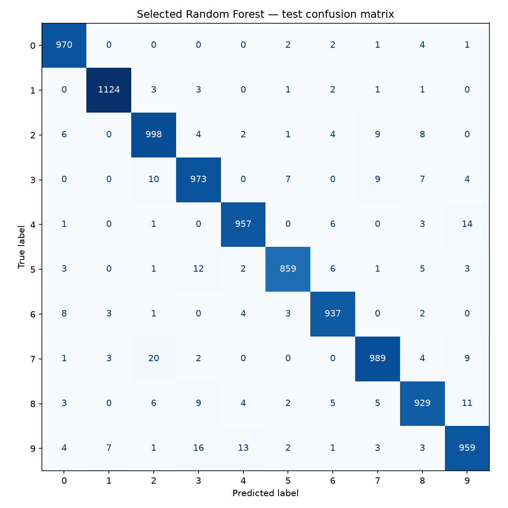
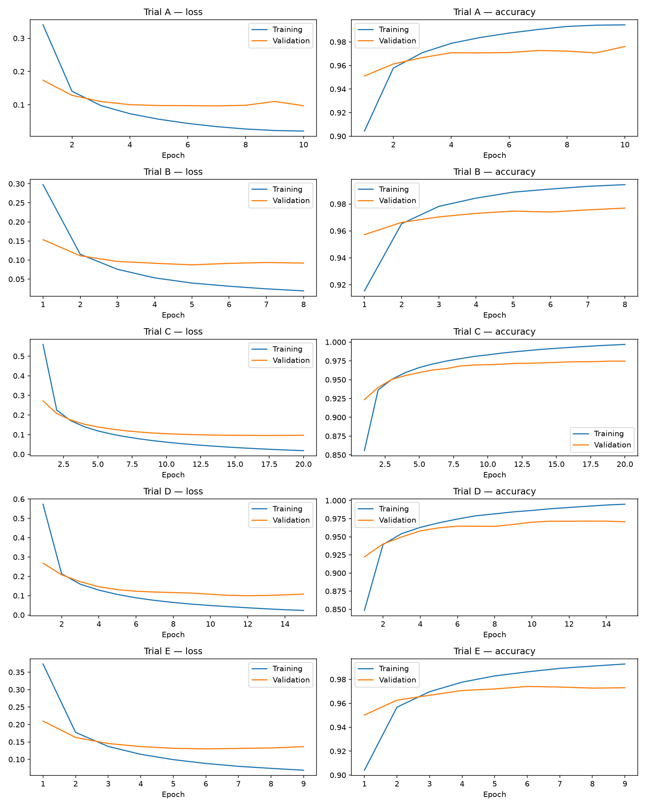
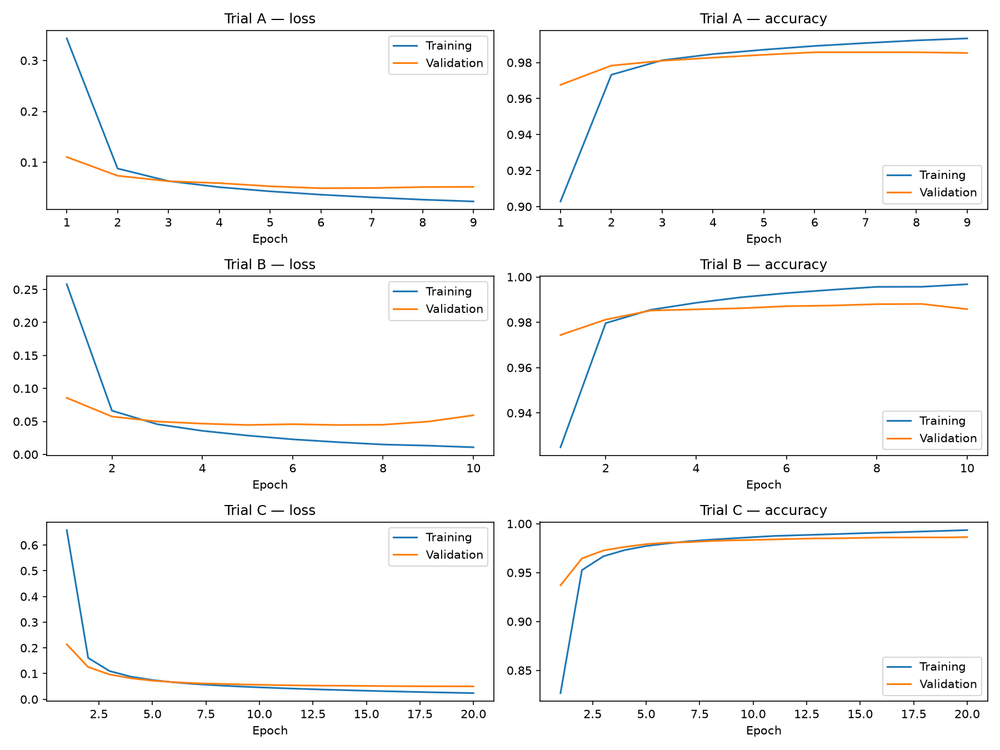
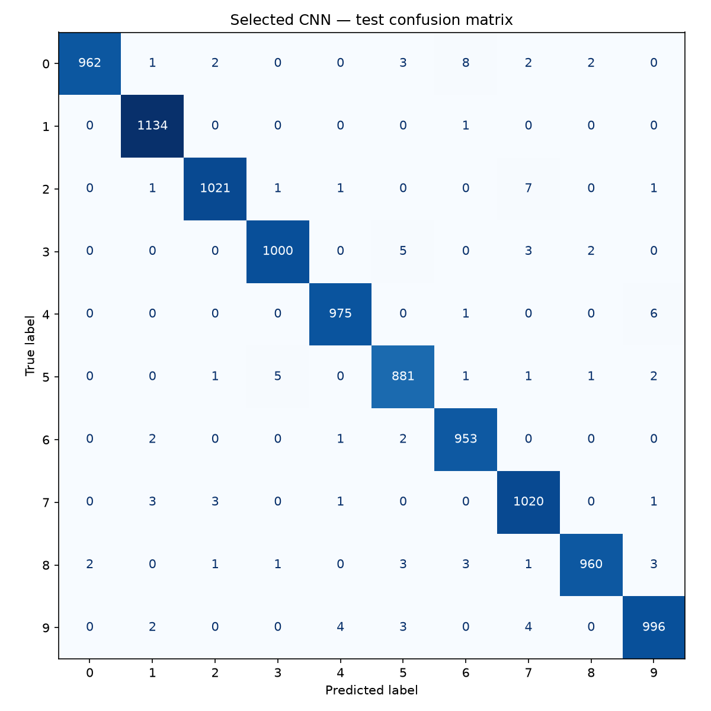

# Assignment 1: MNIST Digit Recognition

## Objective and deliverables

Compare three model families for handwritten digits: a classical Random Forest, a fully connected MLP, and a simple CNN. Tune their hyperparameters, save one selected model per family, and justify the best choice using accuracy, generalization, complexity, and computational cost. The [Streamlit application](https://mnist-digit-classifier-aast.streamlit.app/) lets a user draw a digit and switch between the three saved models. Training source is provided in the three separate notebooks; application instructions and function explanations are in [README.md](README.md).

## Data preprocessing and experimental methodology

MNIST contains 28×28 grayscale images labeled 0–9. Its 60,000 development images are split into **50,000 training** and **10,000 validation** images with `train_test_split`, `random_state=42`, and label stratification. All notebooks use this same split. The original **10,000 test images** remain separate: training fits parameters, validation selects settings/checkpoints, and the test set evaluates the three selected artifacts afterward.

Pixels are cast to `float32` and divided by **255 once**, yielding values in [0, 1]. RF and MLP flatten each image into **784 features**; CNN retains **28×28×1** spatial input. Labels remain integers, paired with sparse categorical cross-entropy in both networks. Scaling supports neural optimization and a common input interface; trees do not depend on scaling in the same way. No augmentation or external training data is used.

The search compares controlled alternatives rather than using defaults alone. Every trial uses seed 42. Neural trials reset the seed and request deterministic TensorFlow operations. Results come from one run per configuration, so small validation differences are observations, not evidence of statistically certain improvements across repeated runs.

## Hyperparameter search and final choices

### Random Forest

| Trial | Trees | Maximum depth | Training accuracy | Validation accuracy | Fit time, s |
| --- | --- | --- | --- | --- | --- |
| A | 50 | 20 | 99.94% | 96.31% | 2.19 |
| B | 100 | 20 | 99.94% | 96.58% | 4.23 |
| **C** | **100** | **Unlimited** | **100.00%** | **96.65%** | **4.33** |

A→B tests whether more trees improve the ensemble; B→C tests whether a depth cap limits useful decisions. Increasing tree count improves validation accuracy by **0.27 percentage points**; removing the depth cap adds **0.07 points**. Select highest validation accuracy, breaking ties by fewer trees, shallower depth, then trial name. **C wins**, balancing the measured accuracy gain against a larger forest and greater overfitting risk. Other classifier settings remain at library defaults; seed and parallelism are set explicitly. The selected model has **862,140 nodes**, observed maximum depth **41**, and averages tree class-probability estimates. It is saved as compressed `rf_final.joblib`.

### Fully connected MLP

| Trial | Hidden units | Learning rate | Batch | L2 | Best epoch / epochs run | Validation accuracy |
| --- | --- | --- | --- | --- | --- | --- |
| A | 128, 128 | 0.001 | 128 | 0 | 7 / 10 | 97.27% |
| **B** | **256, 128** | **0.001** | **128** | **0** | **5 / 8** | **97.47%** |
| C | 128, 128 | 0.0003 | 128 | 0 | 17 / 20 | 97.39% |
| D | 128, 128 | 0.001 | 512 | 0 | 12 / 15 | 97.14% |
| E | 128, 128 | 0.001 | 128 | 0.0001 | 6 / 9 | 97.41% |

The baseline has two Dense/ReLU hidden layers and ten softmax outputs. Each alternative changes one baseline setting: width increases capacity; a lower learning rate tests smaller updates; batch 512 tests fewer updates per epoch; L2 penalizes large weights. All trials use Adam and a 20-epoch limit.

**B wins:** `784 → 256 ReLU → 128 ReLU → 10 softmax`, learning rate **0.001**, batch **128**, no L2. It has **235,146 parameters** and improves validation accuracy by **0.20 points** over A. C requires more epochs without exceeding B; D is faster per search trial but less accurate; E is close but does not win. The chosen MLP uses only fully connected layers, with no active Dropout.

### Simple CNN

| Trial | Convolution filters | Learning rate | Best epoch / epochs run | Validation accuracy |
| --- | --- | --- | --- | --- |
| A | 16, 32 | 0.001 | 6 / 9 | 98.57% |
| **B** | **32, 64** | **0.001** | **7 / 10** | **98.74%** |
| C | 16, 32 | 0.0003 | 20 / 20 | 98.63% |

Each network has two 3×3 convolution/ReLU stages, each followed by 2×2 max pooling, then Flatten, Dense(64, ReLU), and Dense(10, softmax). Batch size is **128** and Adam is used. This is a basic CNN with no pretrained model.

More filters test additional feature capacity; the lower learning rate tests slower optimization. **B wins** with **32/64 filters**, learning rate **0.001**, and **121,930 parameters**, improving validation accuracy by **0.17 points** over A. C reaches the 20-epoch limit and does not surpass B. Shared convolutional weights exploit local image structure while keeping the selected network smaller than the MLP.

### Checkpoint and selection policy

Both networks use `ModelCheckpoint` to save each trial's **minimum-validation-loss** checkpoint, `EarlyStopping` with **patience 3** and restored best weights, and `TerminateOnNaN`. The saved checkpoints are reloaded and ranked by validation accuracy, then lower validation loss, fewer parameters, and trial name. Thus the best epoch in the tables refers to minimum loss, not necessarily maximum accuracy. L2 adds a penalty to reported loss, so cross-trial losses with different penalties are not pure predictive cross-entropy comparisons. The final artifacts are the selected checkpoints; no additional fit on all 60,000 development images is performed.

## Training results and test comparison

The selected saved models are reloaded and evaluated on the same 10,000 test images. Validation predictions are also used to verify save/reload consistency. Accuracy measures correct classifications; macro precision, recall, and F1 give equal weight to each of the ten digit classes.

| Model | Test accuracy | Macro precision | Macro recall | Macro F1 | Test errors | Saved size, MiB |
| --- | --- | --- | --- | --- | --- | --- |
| Random Forest | 96.95% | 0.9694 | 0.9692 | 0.9693 | 305 | 18.94 |
| MLP | 97.62% | 0.9763 | 0.9760 | 0.9761 | 238 | 2.72 |
| **CNN** | **99.02%** | **0.9901** | **0.9900** | **0.9901** | **98** | **1.43** |

| Model | Selected fit, s | Total search fit, s | Warmed 10,000-image inference, s | Complexity |
| --- | --- | --- | --- | --- |
| Random Forest | 4.33 | 10.74 | 0.12 | 100 trees / 862,140 nodes |
| MLP | 39.74 | 253.93 | 0.43 | 235,146 parameters |
| CNN | 54.91 | 212.81 | 0.72 | 121,930 parameters |

RF timings used CPU; neural training and batch inference used GPU. Neural fit times include checkpoint activity. These hardware-dependent measurements are **not a same-device speed comparison**. Search totals also reflect three RF trials, five MLP trials, three CNN trials, and different stopping epochs. Tree nodes and neural parameters measure different kinds of complexity; compressed disk size is not runtime memory.

For application-oriented comparison, 100 warmed single-image CPU calls per model gave median execution times of **5.06 ms RF**, **1.98 ms MLP**, and **5.20 ms CNN**. These exclude image preprocessing, browser rendering, and network latency; cold starts can take longer.

## Generalization and interpretation of figures

RF's training/validation accuracy gap is **3.35 points**; MLP's is **1.41** and CNN's **0.69** at their selected epochs. These describe the measured run. Neural training accuracy is averaged while weights change, so its difference from checkpoint validation accuracy is not a matched-weight generalization estimate. Falling training loss with rising validation loss motivates retaining an earlier checkpoint.

The five figures below are generated by the notebooks and explain both learning behavior and remaining errors. Confusion matrices contain raw test counts, with **true digits on rows** and **predicted digits on columns**; diagonal cells are correct classifications. There are 10,000 examples per matrix.

**Figure 1 — Random Forest.** There are 305 mistakes. Frequent off-diagonal errors are true 7 predicted as 2 (**20**), 9 as 3 (**16**), and 4 as 9 (**14**). The model captures useful pixel decisions but leaves more errors than either network.

**Figure 2 — MLP learning curves.** Each row is a trial; the left plot shows loss and the right accuracy. Blue is training and orange validation. Trial B's minimum validation loss occurs at epoch **5**; training continues to epoch 8 before early stopping. A later epoch can have slightly higher accuracy yet worse loss, so the saved checkpoint follows the declared loss policy. C improves more slowly at the lower learning rate. E's loss includes L2 and should not be compared directly with unpenalized loss as predictive error alone.

**Figure 3 — MLP.** The selected model makes 238 errors. Common confusions are 4 as 9 (**21**), 5 as 3 (**11**), and 8 as 3 (**9**). Better overall accuracy than RF does not imply improvement for every individual digit pair.

**Figure 4 — CNN learning curves.** The selected B checkpoint is epoch **7**. Continued reduction of training loss with deterioration of validation loss afterward supports checkpointing instead of retaining the last epoch. C improves gradually through epoch 20 without beating B's selected checkpoint. The curves show why an epoch limit, learning rate, and early stopping all matter.

**Figure 5 — CNN.** The selected model makes only 98 errors. Frequent remaining confusions include 0 as 6 (**8**), 2 as 7 (**7**), and 4 as 9 (**6**). Similar stroke shapes are a plausible explanation for these pairs, although the matrix alone does not prove the cause of each mistake.

## Best-model decision and trade-offs

**CNN is recommended**, selected by its highest validation accuracy (**98.74%**) before inspecting test results. Its independent test accuracy (**99.02%**) exceeds MLP by **1.40 percentage points** and RF by **2.07 points**. Its highest macro F1, smallest descriptive training/validation gap, and substantially fewer test mistakes support generalization on MNIST. Local spatial filters and shared weights suit handwritten image recognition. Despite having fewer parameters than MLP, it also achieves better accuracy and the smallest saved file.

The choice has costs: CNN's selected fit takes longer than MLP's in the measured neural environment, and convolution makes its warmed single-image CPU execution slower. MLP is a reasonable alternative when that measured latency matters most; RF provides a fast-fitting classical baseline but has lower accuracy and a larger artifact. All three remain available in the app. The evidence favors CNN for this task, without claiming it is always the best classifier for every deployment or dataset.

## Application, limitations, and next steps

The Streamlit app loads the saved artifacts and performs inference without training. A 280×280 mouse/touch canvas supplies a PNG. Preparation composites onto black, converts to grayscale, rejects blank input, crops foreground, resizes the longest side to 20 pixels while preserving aspect ratio, centers by intensity within 28×28, and normalizes once. RF/MLP receive a flat batch; CNN receives an image batch. The app displays a digit, scores, execution time, and the actual processed image. Clear resets the canvas; editing or switching models invalidates old results. Cached models reduce repeated loading.

MNIST performance does not establish accuracy on unrestricted handwriting or photographs. Scores are not calibrated confidence, and a non-digit can still receive a digit prediction. The small single-seed search leaves uncertainty about repeatability and other configurations. Useful next steps are repeated-seed evaluation and a labeled canvas-drawing benchmark. Image upload is a future extension requiring explicit background/polarity preprocessing and evaluation. The existing drawing application is available at [mnist-digit-classifier-aast.streamlit.app](https://mnist-digit-classifier-aast.streamlit.app/); [README.md](README.md) explains setup, file roles, functions, and deployment behavior.
